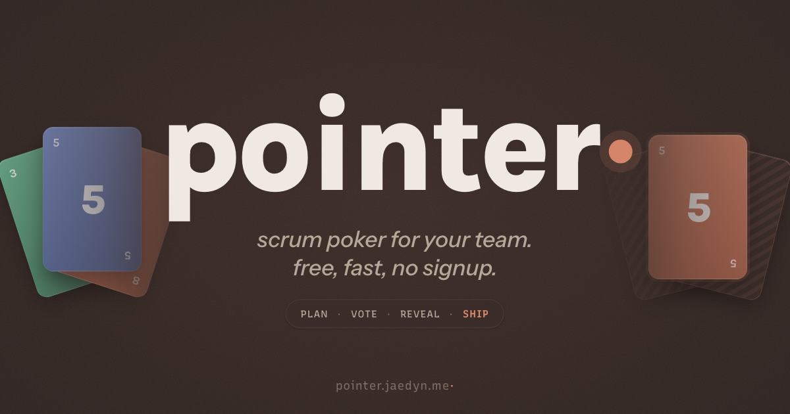

# pointer

> Scrum poker for your team. Free, fast, no signup.



Real-time planning poker for agile estimation. Create a room, share the link, vote privately, reveal together. A single Node.js process with one dependency ([`ws`](https://github.com/websockets/ws)), no database, no accounts.

## Features

- **Instant rooms** — create and share a link, no signup
- **Private voting** — estimates stay hidden until the host reveals
- **3-second countdown** — reveal with anticipation
- **4 voting systems** — T-shirt (XS–XL), Fibonacci, Powers of 2, Simple (1–5)
- **Host auto-promotion** — if the host disconnects, the next player takes over after 60s
- **Reconnection window** — 60s to rejoin without losing your seat
- **12-color player palette** — deterministic, no duplicates
- **Persistent names** — remembered across sessions via localStorage

## Self-Hosting

```bash
docker build -t pointer .
docker run -p 3000:3000 pointer
```

Or run directly:

```bash
npm install
node server.js
```

## Testing

```bash
npm test
```

88 tests (56 unit + 32 integration), Node's built-in test runner, zero dev dependencies.

## License

MIT
